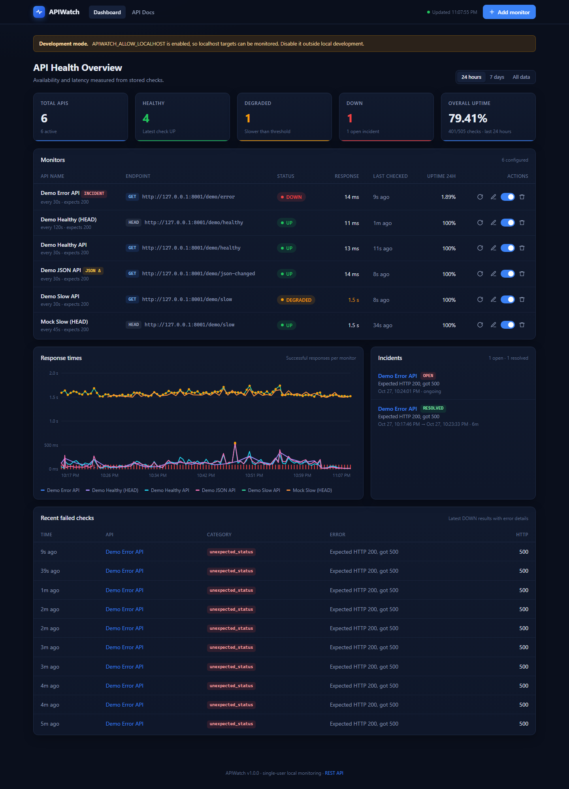
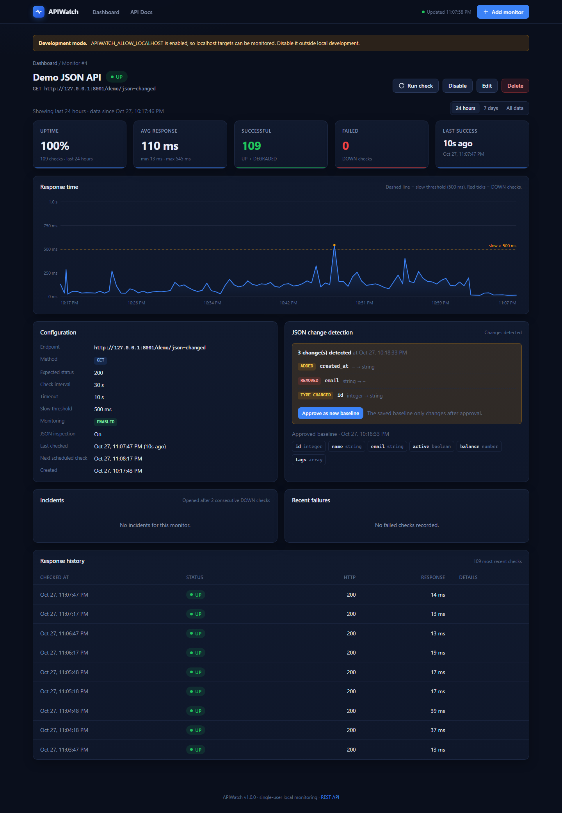
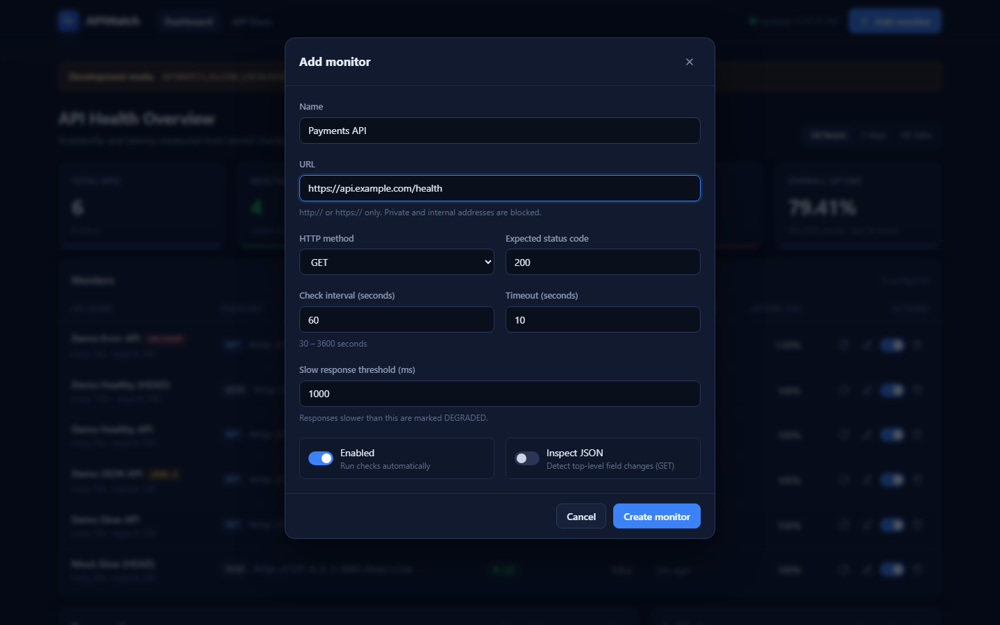
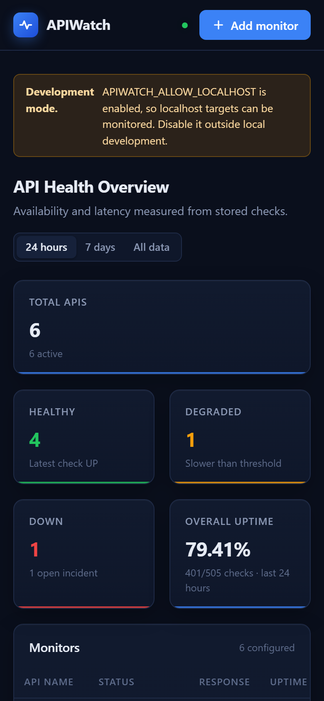
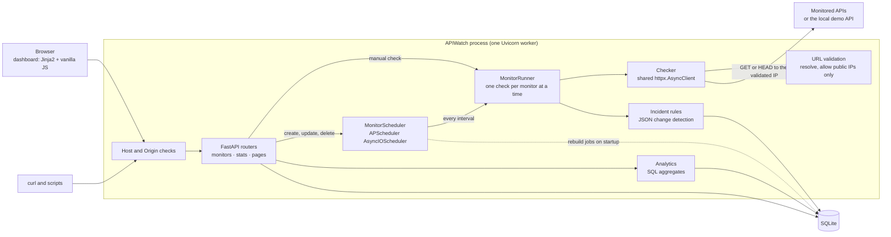

# APIWatch

[](https://github.com/berkdogutan/ApiWatch/actions/workflows/ci.yml)
[](pyproject.toml)
[](LICENSE)

**A self-hosted API monitoring dashboard built with Python, FastAPI and SQLite.**
APIWatch checks your HTTP endpoints on a schedule and records each check's status code and
response time. It opens incidents when an endpoint keeps failing and flags changes in the
shape of JSON responses.

APIWatch is a single-process tool for a developer who wants to watch a handful of APIs from
their own machine. There are no agents, no external services and no API keys. It runs
`uv sync` and `uv run apiwatch`, and keeps everything in one SQLite file. The rules are
deliberately simple and visible. A check is **UP**, **DEGRADED** (slower than your
threshold) or **DOWN**. An incident opens after two consecutive DOWN checks. A change
in a JSON response is reported but never accepted until you approve it. Every number on
the dashboard is computed from checks that actually ran.



| Monitor details | Add / edit monitor | Mobile layout |
| --- | --- | --- |
|  |  |  |

*Screenshots of the running application monitoring the bundled demo API
(captured with [`docs/capture_screenshots.py`](docs/capture_screenshots.py)). The yellow
banner appears because the demo enables localhost targets.*

## Contents

- [Features](#features)
- [Architecture](#architecture)
- [Technology stack](#technology-stack)
- [Quick start](#quick-start)
- [Local demo](#local-demo)
- [API and example requests](#api-and-example-requests)
- [Configuration](#configuration)
- [Running tests](#running-tests)
- [Security and deployment limitations](#security-and-deployment-limitations)
- [Roadmap](#roadmap)
- [Contributing](#contributing)
- [License](#license)

## Features

**Monitors**
- Add, edit, delete, pause and resume monitors from the dashboard or the REST API.
- Per monitor: URL, `GET` or `HEAD`, expected status code, interval (30–3600 s, default
  60 s), timeout (≤ 30 s), slow-response threshold, optional JSON inspection.
- Run any check on demand.

**Health checks**
- Asynchronous checks with one shared `httpx.AsyncClient`. Timing uses a monotonic clock.
- **UP**: expected status code and latency ≤ the slow threshold.
- **DEGRADED**: expected status code, but slower than the threshold.
- **DOWN**: timeout, DNS or connection failure, blocked target or unexpected status code.
- Each result stores a typed error category (`timeout`, `dns_error`, `connection_error`,
  `unexpected_status`, `invalid_url`, `invalid_json`, …) and a short sanitized message.
  No response bodies or credentials are stored.
- The timeout is a deadline for the whole check: DNS lookup, connection and response.

**Scheduling**
- APScheduler 3 `AsyncIOScheduler` with one job per enabled monitor.
- Jobs are updated as soon as a monitor changes and rebuilt from SQLite on startup.
- A monitor never has two checks running at once. Shutdown cancels in-flight checks
  without writing partial results.

**Analytics** (computed in SQL from stored checks)
- Total, successful and failed checks.
- Uptime %, average / minimum / maximum response time, last successful check.
- Windows: last 24 hours, last 7 days or all data. Shows **N/A** rather than 100 % when
  there is no data.

**Incidents**
- Opened after 2 consecutive DOWN checks (configurable). Never duplicated while open.
- Resolved by the next UP or DEGRADED check. Start time, recovery time and reason are kept.

**JSON change detection** (optional, per monitor)
- Records the top-level keys and value types of a JSON object response as a baseline.
- Reports added, removed and type-changed fields. The baseline changes only when you
  approve it.

**Dashboard**
- Summary cards, a monitor table with actions and a multi-series response-time chart.
- Incidents, recent failed checks and a details page per monitor.
- Dark, responsive layout with no CDN dependencies. The chart is a small hand-written SVG
  renderer.

## Architecture



**How a check runs:**
1. The scheduler or `POST /api/monitors/{id}/check` calls `MonitorRunner.check_monitor`.
   It refuses to start a second check of the same monitor and runs at most 20 checks at
   once.
2. The URL is validated again and the host is resolved. Every resolved address must be
   allowed.
3. The request connects to one of those validated addresses. The `Host` header, TLS SNI
   and certificate verification still use the original hostname. Redirects are not
   followed.
4. The result is stored, then incident and JSON-change rules run in the same transaction.

> **One worker only.** The scheduler runs inside the web process. Run a single Uvicorn
> worker, which is what `uv run apiwatch` does. With several workers or replicas, every
> process would schedule its own copy of each check.

<details>
<summary>Project layout</summary>

```
app/
  main.py              app factory, lifespan, middleware, `apiwatch` entry point
  config.py            settings from APIWATCH_* environment variables / .env
  database.py          engine, sessions, table creation (`python -m app.database`)
  models/              Monitor, CheckResult, Incident, JsonBaseline
  schemas/             Pydantic request/response models
  routers/             monitors.py, stats.py (stats, incidents, failures, health), pages.py
  services/
    url_validation.py  scheme / host / IP rules (SSRF protection)
    checker.py         one HTTP check -> UP / DEGRADED / DOWN
    monitoring.py      MonitorRunner: run, persist, incidents, JSON changes
    scheduler.py       APScheduler job management
    incidents.py       open / resolve rules
    json_changes.py    top-level key/type comparison and approval
    analytics.py       uptime and latency statistics in SQL
  templates/ static/   dashboard (Jinja2, CSS, JavaScript, SVG chart)
demo/
  mock_api.py          deterministic local API (/demo/*)
  seed.py              creates sample monitors through the REST API
tests/                 pytest suite; HTTP and DNS are mocked
docs/                  screenshots, capture script, release notes
```
</details>

## Technology stack

| Area | Technology |
| --- | --- |
| Language | Python 3.12+ (CI: 3.12 and 3.13) |
| Web | FastAPI, Uvicorn, Jinja2 |
| HTTP client | HTTPX `AsyncClient` |
| Persistence | SQLAlchemy 2.x, SQLite |
| Scheduling | APScheduler 3.x `AsyncIOScheduler` |
| Validation and settings | Pydantic v2, pydantic-settings |
| Frontend | Vanilla JavaScript, CSS, local SVG chart |
| Quality | pytest, pytest-asyncio, Ruff, GitHub Actions |
| Packaging | uv with `pyproject.toml` and a committed `uv.lock` |

## Quick start

Requirements: Python 3.12 or newer and [uv](https://docs.astral.sh/uv/getting-started/installation/).

```bash
git clone https://github.com/berkdogutan/ApiWatch.git
cd ApiWatch
uv sync
uv run apiwatch
```

Open <http://127.0.0.1:8000>, click **Add monitor**, enter a name and an `https://` URL,
and save. Use the ↻ button to run a check immediately. Enabled monitors are then checked
automatically at their interval.

The SQLite database (`data/apiwatch.db`) and its tables are created on first start. To
create them without starting the server, run `uv run python -m app.database`.

## Local demo

The demo needs no internet access or API keys. A small mock API runs on
`127.0.0.1:8001`. Monitoring localhost is blocked by default, so start APIWatch with the
**development-only** switch `APIWATCH_ALLOW_LOCALHOST=true`.

**Terminal 1 – mock API**

```bash
uv run python -m demo.mock_api
```

**Terminal 2 – APIWatch with localhost targets allowed**

```bash
# macOS / Linux
APIWATCH_ALLOW_LOCALHOST=true uv run apiwatch
```

```powershell
# Windows PowerShell
$env:APIWATCH_ALLOW_LOCALHOST = "true"; uv run apiwatch
```

**Terminal 3 – create five sample monitors**

```bash
uv run python -m demo.seed
```

You can also put `APIWATCH_ALLOW_LOCALHOST=true` in a local `.env` file, which is
git-ignored. While the switch is on, the dashboard shows a *Development mode* banner.

| Demo endpoint | Behaviour | Result in APIWatch |
| --- | --- | --- |
| `/demo/healthy` | `200` immediately | UP |
| `/demo/slow` | `200` after 1.5 s (`MOCK_SLOW_DELAY_SECONDS`) | DEGRADED (threshold 800 ms) |
| `/demo/error` | `500` | DOWN; incident after 2 checks |
| `/demo/json` | fixed JSON object | UP; JSON baseline captured |
| `/demo/json-changed` | `email` removed, `id` integer → string, `created_at` added | UP; 3 JSON changes |

Things to try:
1. **Simulate an outage.** Edit "Demo Healthy API" and set its URL to
   `http://127.0.0.1:8001/demo/error`, or stop the mock API. An incident opens after two
   checks. Change the URL back and the incident is resolved on the next check.
2. **Review a JSON change.** Edit "Demo JSON API", change `/demo/json` to
   `/demo/json-changed`, and run a check. On its details page, review the three changes
   and click **Approve as new baseline**.
3. **Pause monitoring.** Toggle a monitor off. Its scheduled job is removed immediately.

## API and example requests

Interactive documentation: <http://127.0.0.1:8000/docs> (Swagger UI) and `/redoc`. FastAPI
loads the assets for these two pages from a CDN. The dashboard itself loads nothing
external.

| Method | Path | Description |
| --- | --- | --- |
| `GET` | `/api/monitors` | Monitors with current status, last response time and 24 h uptime |
| `POST` | `/api/monitors` | Create a monitor (`201`); only `name` and `url` are required |
| `GET` | `/api/monitors/{id}` | One monitor |
| `PUT` | `/api/monitors/{id}` | Replace a monitor's configuration (all fields required) |
| `DELETE` | `/api/monitors/{id}` | Delete a monitor and its history (`204`) |
| `POST` | `/api/monitors/{id}/check` | Run a check now (`409` if one is already running) |
| `GET` | `/api/monitors/{id}/history` | Results and statistics. `window=24h\|7d\|all`, `limit`, `points` (sampling for charts) |
| `GET` | `/api/monitors/{id}/json-baseline` | Approved JSON baseline and pending changes |
| `POST` | `/api/monitors/{id}/json-baseline/approve` | Accept pending JSON changes as the new baseline |
| `GET` | `/api/stats` | Status counts and overall uptime; `window=24h\|7d\|all` |
| `GET` | `/api/incidents` | Incidents; `status=open\|resolved\|all`, `monitor_id`, `limit` |
| `GET` | `/api/failures` | Most recent failed checks with error details |
| `GET` | `/health` | Database and scheduler status |

Error responses:
- Validation errors return `422` in FastAPI's standard format.
- A duplicate monitor name returns `409`. Unknown IDs return `404`.
- All timestamps are UTC ISO-8601 strings ending in `Z`.

```bash
# Create a monitor
curl -X POST http://127.0.0.1:8000/api/monitors \
  -H "Content-Type: application/json" \
  -d '{"name": "GitHub API", "url": "https://api.github.com", "interval_seconds": 120,
       "timeout_seconds": 10, "slow_threshold_ms": 800, "inspect_json": true}'
```

```bash
# Run a check immediately
curl -X POST http://127.0.0.1:8000/api/monitors/1/check
```

```json
{
  "id": 42, "monitor_id": 1, "checked_at": "2026-10-27T19:18:34.026672Z",
  "response_time_ms": 27.31, "status_code": 200, "status": "UP", "success": true,
  "error_category": null, "error_message": null
}
```

```bash
# Last 7 days of history and statistics
curl "http://127.0.0.1:8000/api/monitors/1/history?window=7d&limit=50"

# Pause a monitor: PUT replaces the configuration, so send every field
curl -X PUT http://127.0.0.1:8000/api/monitors/1 -H "Content-Type: application/json" \
  -d '{"name": "GitHub API", "url": "https://api.github.com", "method": "GET",
       "expected_status": 200, "interval_seconds": 120, "timeout_seconds": 10,
       "slow_threshold_ms": 800, "enabled": false, "inspect_json": true}'

# Open incidents
curl "http://127.0.0.1:8000/api/incidents?status=open"
```

A target that is not allowed is rejected with a readable message:

```bash
curl -X POST http://127.0.0.1:8000/api/monitors -H "Content-Type: application/json" \
  -d '{"name": "metadata", "url": "http://169.254.169.254/latest/meta-data/"}'
# 422 {"detail":[{"loc":["body","url"],"msg":"Host '169.254.169.254' resolves to a private or reserved address (169.254.169.254)", ...}]}
```

On Windows PowerShell, call `curl.exe` explicitly; `curl` is an alias for
`Invoke-WebRequest` there.

## Configuration

Settings are read from environment variables or a `.env` file. See
[`.env.example`](.env.example) for all of them.

| Variable | Default | Purpose |
| --- | --- | --- |
| `APIWATCH_DATABASE_URL` | `sqlite:///./data/apiwatch.db` | SQLite database location |
| `APIWATCH_HOST` / `APIWATCH_PORT` | `127.0.0.1` / `8000` | Server binding |
| `APIWATCH_TRUSTED_HOSTS` | `127.0.0.1,localhost` | Accepted `Host` headers |
| `APIWATCH_ALLOW_LOCALHOST` | `false` | Development only: allow loopback targets |
| `APIWATCH_ALLOWED_TARGET_HOSTS` | *(empty = any public host)* | Allowlist of monitor hosts, e.g. `api.example.com,*.example.org` |
| `APIWATCH_MAX_RESPONSE_BYTES` | `1048576` | Bytes read when inspecting JSON |
| `APIWATCH_SCHEDULER_ENABLED` | `true` | Turn automatic checks off |
| `APIWATCH_INCIDENT_FAILURE_THRESHOLD` | `2` | Consecutive DOWN checks that open an incident |

## Running tests

```bash
uv run pytest                 # 95 tests
uv run ruff check .           # lint
uv run ruff format --check .  # formatting
```

The tests use `httpx.MockTransport` for HTTP and a fake resolver for DNS. An autouse
fixture makes any real DNS lookup or outbound connection fail, so the suite cannot
depend on internet access. It covers:
- monitor CRUD and validation, including strict `PUT`;
- URL and SSRF rules, including IPv6 transition ranges, and connecting to the validated
  address;
- check outcomes: success, slow responses, unexpected status codes, timeouts, DNS and
  connection failures, redirects, invalid JSON and size limits;
- uptime and latency statistics, empty history, time windows and chart sampling;
- incident opening, de-duplication and recovery;
- JSON baseline comparison and approval;
- Host-header and cross-origin protection;
- enable/disable behaviour, overlap prevention and the scheduler lifecycle (including
  shutdown during a check and rebuilding jobs after a restart).

GitHub Actions runs Ruff and pytest on Python 3.12 and 3.13 for every push to `main` and
every pull request (see [`.github/workflows/ci.yml`](.github/workflows/ci.yml)).

## Security and deployment limitations

APIWatch is a **single-user tool for local use**. It has **no authentication**. Anyone
who can reach its port can create monitors and make it send requests. Keep the default
`127.0.0.1` binding and do not expose it to untrusted networks or the public internet.
It is not designed or tested for production deployment.

**Outbound requests (SSRF protection).**
- Only `http` and `https` URLs are accepted. URLs containing credentials are rejected.
  Redirects are never followed, and proxy settings and `.netrc` files are ignored.
- Every address a hostname resolves to must be public. Loopback, private (RFC 1918),
  link-local (including `169.254.169.254`), CGNAT, multicast, reserved and IPv6
  transition ranges are rejected, as are well-known cloud-metadata hostnames.
- The rules apply when a monitor is saved and again before every check. The request then
  connects to an address that was just validated instead of resolving the name a second
  time. This closes the DNS-rebinding window between the check and the connection.
- `APIWATCH_ALLOWED_TARGET_HOSTS` narrows which hostnames may be monitored. Allowlisted
  names must still resolve to public addresses.

**Requests to APIWatch itself.**
- Requests whose `Host` header is not in `APIWATCH_TRUSTED_HOSTS` are rejected. This
  stops a malicious web page from driving the API through DNS rebinding.
- Browser requests that change data must come from the dashboard's own origin. This
  prevents cross-site request forgery.
- Pages cannot be embedded in frames.

**What these measures do not cover:**
- A public address can still forward traffic inward, for example an open proxy, a port
  forward or a load balancer in front of a private network. APIWatch cannot tell such a
  host apart from any other public host.
- An allowlist limits which names can be used, but not where the owners of those names
  point them on the public internet. It is not a guarantee against SSRF.
- Validation relies on the operating system's resolver. Name-based rules only cover the
  names you configure.
- Rejecting all IPv6 transition ranges means IPv4-only targets reached through NAT64 on
  IPv6-only networks cannot be monitored.
- With `APIWATCH_ALLOW_LOCALHOST=true`, every service on the loopback interface can
  receive `GET` and `HEAD` requests. Use it only for local development.
- The Host and Origin checks defend against browser-based attacks only. They are not
  access control. Anyone who can connect to the port can use the API.

**Other limitations of 1.0.0:**
- **One process.** Several workers or replicas would duplicate scheduled checks.
- **Requests.** Only `GET` and `HEAD`, with no custom headers, request bodies or
  authenticated endpoints. Do not put secrets in monitored URLs: URLs are stored and
  shown in plain text.
- **JSON change detection.** Only top-level keys and JSON types are compared. Invalid or
  non-object JSON is reported as a warning and does not change UP/DEGRADED status.
- **Metrics.** Uptime only covers stored checks, so it says nothing about time before
  monitoring began or while APIWatch was stopped. Overall uptime is check-weighted:
  monitors with shorter intervals count more.
- **Response time.** Every check opens a new connection, so response times include TCP
  and TLS setup. When JSON inspection is on, they also include reading the body. Times
  are measured inside the APIWatch process, so a heavily loaded machine inflates them.
  Monitors start a few seconds apart so their checks don't all run at the same instant.
- **Operations.** No notifications, no history retention and no schema migrations:
  tables are created with `create_all`.

See [SECURITY.md](SECURITY.md) for how to report a vulnerability.

## Roadmap

Ideas for future releases. None of these are implemented in 1.0.0.

- Schema migrations with Alembic
- Notification channels (webhook, email) with cooldowns
- History retention and downsampled long-term statistics
- Custom request headers, with secrets read from environment variables
- Nested JSON comparison
- Optional authentication for shared deployments
- Container image

## Contributing

Bug reports and focused pull requests are welcome. See [CONTRIBUTING.md](CONTRIBUTING.md)
for the development setup and checks, and [CHANGELOG.md](CHANGELOG.md) for release history.

## License

APIWatch is released under the [MIT License](LICENSE).
